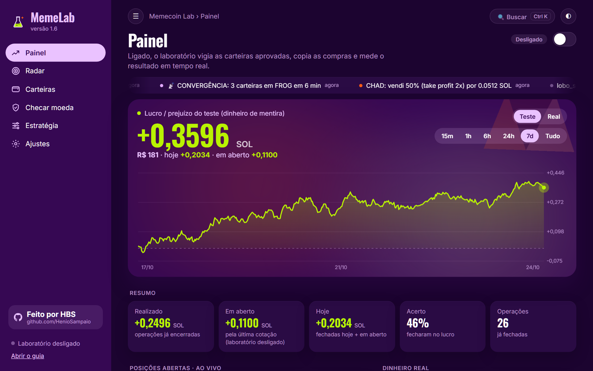
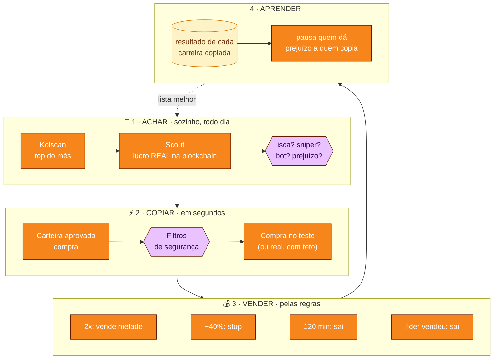
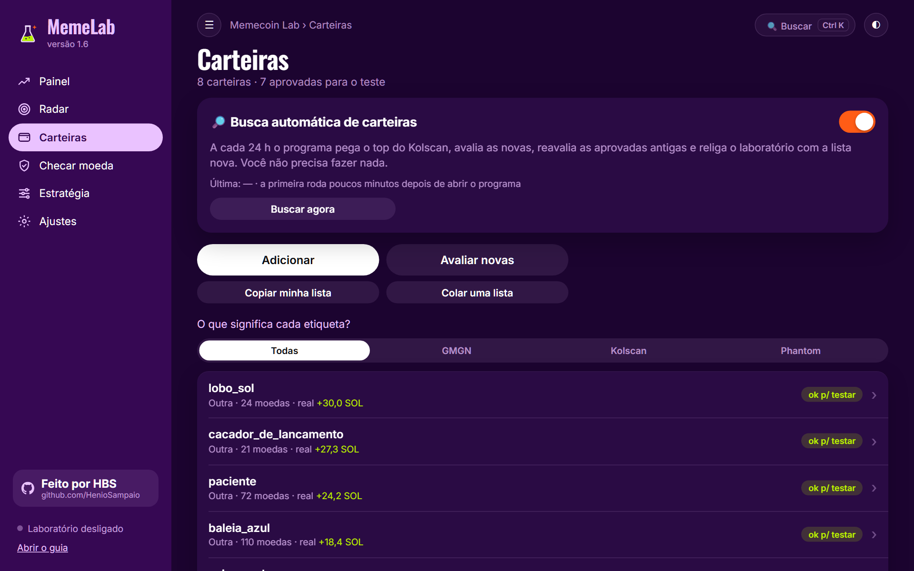
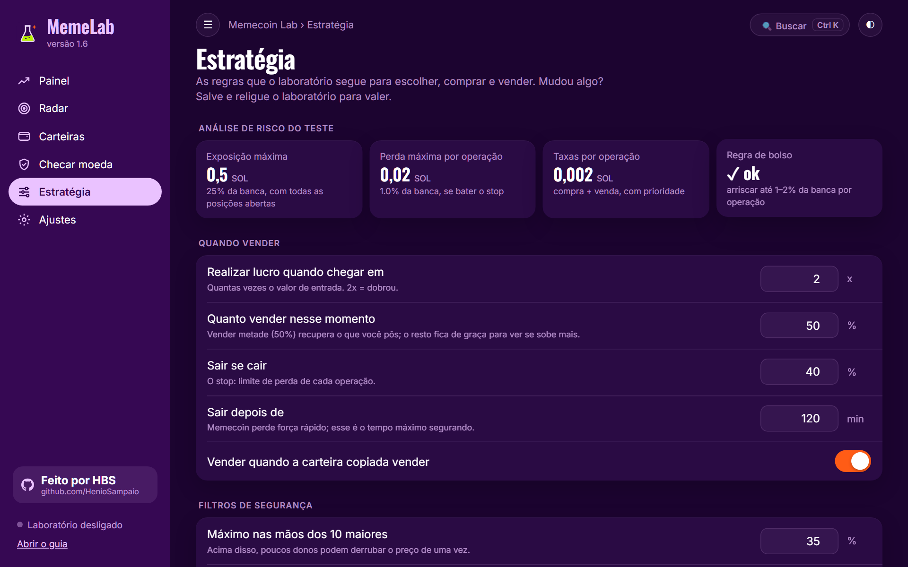

  

<h1 align="center">Memecoin Lab</h1>

  Copia as carteiras que mais lucram com memecoins na Solana, <b>primeiro em papel</b>, 
  e só deixa usar dinheiro de verdade quando o teste provar que dá lucro para quem copia.

  
  
  
  

## O que ele faz

- **Acha carteiras boas sozinho:** todo dia pega o top do Kolscan, lê o histórico real de cada carteira na blockchain e descarta isca, sniper, bot e quem só mostra o lucro e esconde o prejuízo.
- **Copia em papel, com preço de verdade:** quando uma carteira aprovada compra, o laboratório "compra" junto com atraso, taxa e slippage reais (cotação Jupiter), e vende pelas regras: lucro em 2x, stop, tempo e quando o líder vende.
- **Barra moeda perigosa:** dono que ainda pode criar moedas ou congelar, liquidez baixa, 10 maiores com quase tudo, criador com muito.
- **Radar:** avisa quando várias carteiras sem ligação compram a mesma moeda.
- **Aprende:** carteira que dá prejuízo para quem copia é pausada sozinha.
- **Dinheiro real só depois do portão:** 4 semanas, 200 operações e lucro depois das taxas. Mesmo ligado, tem teto por compra, por dia e botão de parar tudo.
- **Telegram:** avisos de compra e venda, painel com botões, vender pelo celular com confirmação, resumo às 21h.

## Instalar

1. Baixe o **MemecoinLab.exe** pelo botão acima.
2. Clique com o botão direito no arquivo → **Propriedades** → marque **Desbloquear** → **OK**.
3. Abra. Se aparecer *"O Windows protegeu o computador"*, clique em **Mais informações → Executar assim mesmo** (o programa não é assinado por empresa).
4. Siga a tela de boas-vindas: chave grátis do Helius, carteiras e ligar o laboratório.

Não precisa instalar Python nem mais nada. Versões novas aparecem sozinhas: **Atualizar agora**, e ele reabre na versão nova.

## Como ele decide

| | Tela | O que mostra |
|:-:|---|---|
| 📈 | **Painel** | Lucro e prejuízo ao vivo, gráfico, posições com termômetro do stop ao alvo, fita do que está acontecendo. |
| 📡 | **Radar** | Moedas que várias das suas carteiras compraram juntas. |
| 👛 | **Carteiras** | Quem é vigiado, a nota de cada uma e a busca automática. |
| 🛡️ | **Checar moeda** | Cole o endereço e veja se passa nos filtros e os sinais sociais. |
| 🎛️ | **Estratégia** | Quando vender, filtros e tamanho das entradas, com análise de risco. |

| Carteiras | Estratégia |
|---|---|
|  |  |

> [!WARNING]
> **Memecoins são de altíssimo risco.** A maioria vai a zero e a maioria de quem copia carteiras perde dinheiro. O programa existe para **medir antes de arriscar**. Não é recomendação de investimento.

<!-- NOVIDADES:INICIO -->
## Novidades

### 2.34 · 25/10/2026
- Corrigido: depois de comprar pelo popup, a tela ficava em branco com "Memecoin Lab › undefined" (os botões de valor eram confundidos com botões de tela).
- Sininho mais confiável: tocar em −20% agora marca o degrau (antes vinha marcado e o toque desmarcava), o valor digitado não some ao trocar de opção, valor vazio não vira "só aviso" escondido, e uma compra que falha por motivo passageiro (Jupiter ocupada, sem rota) tenta de novo por até 10 min em vez de queimar o degrau.
- Telegram: compra com dinheiro real na ficha da moeda, com valor e PIN de 6 números. O bot apaga a mensagem do PIN, o pedido vale 2 min, só o seu chat é atendido e valem os limites do modo real. Só aparece com o dinheiro real ligado.

### 2.33 · 25/10/2026
- Comprar virou botão na ficha da moeda, com popup: Teste ou Dinheiro real, valores rápidos (0,05 a 1 SOL) ou o seu, e o R$ ao lado.
- Dinheiro real na compra manual e no sininho: respeita o teto, o limite de posições, a perda do dia e o saldo da carteira do laboratório; a saída segue as regras da Estratégia. Pelo celular pede o PIN de segurança; no Telegram a compra continua só no teste.
- Por conta própria: valor por compra ajustável (com nota alta vai até o dobro), vale na hora.

### 2.32 · 25/10/2026
- Sininho virou ícone: no topo da ficha da moeda, ao lado da estrela, com o número de degraus armados; tocando, abre um popup para criar e apagar.

### 2.31 · 25/10/2026
- Sininho da moeda: na ficha de qualquer moeda, escolha degraus de queda (−10%, −20%, −30%, −50%, −70%) a partir do preço de agora; em cada um o programa compra no teste um valor em SOL, um % do caixa, ou só avisa. Cada degrau dispara uma vez e avisa no Telegram.
- Favoritas: estrela na ficha da moeda, aba Favoritas no Mercado (com quanto subiu desde que favoritou) e ⭐ Favoritas no Telegram.
- Compra manual e do sininho podem ser um aporte numa moeda que já tem posição aberta.

<!-- NOVIDADES:FIM -->

---

Feito por <b>HBS</b> · <a href="https://github.com/HenioSampaio">github.com/HenioSampaio</a>

