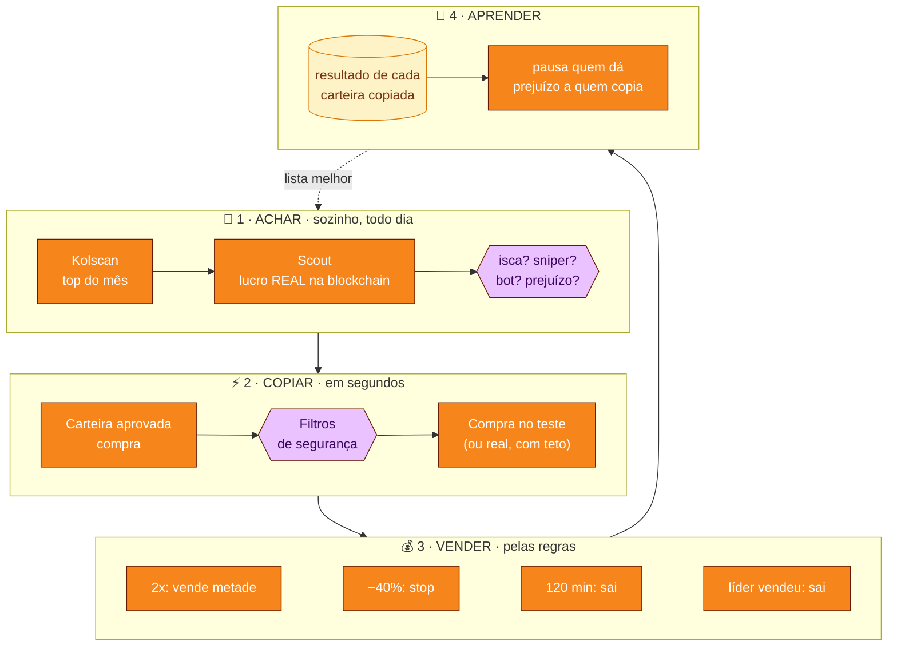

  

<h1 align="center">Memecoin Lab</h1>

  Copia as carteiras que mais lucram com memecoins na Solana, <b>primeiro em papel</b>, 
  e só deixa usar dinheiro de verdade quando o teste provar que dá lucro para quem copia.

  
  
  
  

## O que ele faz

- **Acha carteiras boas sozinho:** todo dia pega o top do Kolscan, lê o histórico real de cada carteira na blockchain e descarta isca, sniper, bot e quem só mostra o lucro e esconde o prejuízo.
- **Copia em papel, com preço de verdade:** quando uma carteira aprovada compra, o laboratório "compra" junto com atraso, taxa e slippage reais (cotação Jupiter), e vende pelas regras: lucro em 2x, stop, tempo e quando o líder vende.
- **Barra moeda perigosa:** dono que ainda pode criar moedas ou congelar, liquidez baixa, 10 maiores com quase tudo, criador com muito.
- **Radar:** avisa quando várias carteiras sem ligação compram a mesma moeda.
- **Aprende:** carteira que dá prejuízo para quem copia é pausada sozinha.
- **Dinheiro real só depois do portão:** 4 semanas, 200 operações e lucro depois das taxas. Mesmo ligado, tem teto por compra, por dia e botão de parar tudo.
- **Telegram:** avisos de compra e venda, painel com botões, vender pelo celular com confirmação, resumo às 21h.

## Instalar

1. Baixe o **MemecoinLab.exe** pelo botão acima.
2. Clique com o botão direito no arquivo → **Propriedades** → marque **Desbloquear** → **OK**.
3. Abra. Se aparecer *"O Windows protegeu o computador"*, clique em **Mais informações → Executar assim mesmo** (o programa não é assinado por empresa).
4. Siga a tela de boas-vindas: chave grátis do Helius, carteiras e ligar o laboratório.

Não precisa instalar Python nem mais nada. Versões novas aparecem sozinhas: **Atualizar agora**, e ele reabre na versão nova.

## Como ele decide

| | Tela | O que mostra |
|:-:|---|---|
| 📈 | **Painel** | Lucro e prejuízo ao vivo, gráfico, posições com termômetro do stop ao alvo, fita do que está acontecendo. |
| 📡 | **Radar** | Moedas que várias das suas carteiras compraram juntas. |
| 👛 | **Carteiras** | Quem é vigiado, a nota de cada uma e a busca automática. |
| 🛡️ | **Checar moeda** | Cole o endereço e veja se passa nos filtros e os sinais sociais. |
| 🎛️ | **Estratégia** | Quando vender, filtros e tamanho das entradas, com análise de risco. |

| Carteiras | Estratégia |
|---|---|
|  |  |

> [!WARNING]
> **Memecoins são de altíssimo risco.** A maioria vai a zero e a maioria de quem copia carteiras perde dinheiro. O programa existe para **medir antes de arriscar**. Não é recomendação de investimento.

<!-- NOVIDADES:INICIO -->
## Novidades

### 2.41 · 26/10/2026
- Meu saldo: Compras e Vendas entraram dentro do card roxo do caixa (sumiram os dois cards brancos separados).
- Grafico da moeda: corrige tela vazia no 1m (nao cacheia falha do GeckoTerminal, ignora resposta atrasada ao trocar o periodo e redesenha quando a janela termina de abrir).

### 2.40 · 26/10/2026
- Meu saldo no estilo Apple: saldo grande no topo, resultado em pílula colorida, métricas limpas.
- Extrato com filtros em segmento: Tudo / Compras / Vendas e período 1D · 1S · 1M · Tudo.

### 2.39 · 26/10/2026
- Mercado: o gráfico de quem mais subiu na última hora voltou ao visual certo (as barras e a % tinham sido esmagadas por um estilo novo do Holder).
- Meu saldo: visual no estilo do Holder — resultado grande no topo, saldo/livre/investido em faixa, compras e vendas compactas, menos texto.

### 2.38 · 26/10/2026
- Holder com visual novo: resumo no topo com o valor dos holds abertos em R$, quanto foi investido e o resultado em %, além de holds abertos, orçamento usado, valor por hold e nota mínima (com barras). O texto longo virou um "Como funciona" que abre e fecha.
- Cada hold aberto virou um cartão: ícone da moeda, selo teste/real, nota num anel colorido, múltiplo atual (ex.: 0,05x) com a variação em %, pico, minigráfico do preço, a escada 2x/5x/10x/70x com ✓ nos degraus alcançados, motivos em etiquetas e riscos em laranja, e botões Abrir ficha, Gráfico, DexScreener e Vender (só no teste, pede confirmação).
- Retorno médio com e sem os 3 maiores em dois cartões, com barras de quantos holds chegaram a cada degrau. Novo histórico dos holds fechados (motivo, duração, pico e resultado em R$); tocar abre a operação.
- Gráfico da moeda: novos períodos 1D (último dia, velas de 15 min), 1S (última semana, velas de 1 h) e Tudo (desde a criação; a vela se ajusta à idade da moeda: 15 min, 1 h, 4 h ou 1 dia). Funciona em Velas e Linha, com as marcações de compra e venda e a última vela ao vivo. Moedas novas mostram só o que já existe.
- Ritmo das últimas 24 h: as barras agora são clicáveis (mouse, toque ou teclado), com destaque e dica ao passar o mouse. Tocar numa hora mostra as compras das carteiras naquela hora agrupadas por moeda: quem comprou, quando, o que o laboratório fez (copiou, barrou e por quê, observou), quando várias carteiras entraram juntas e o resultado; tocar na moeda abre a ficha. A linha da tabela Hora a hora também abre a hora.
- Por conta própria com o mesmo visual do Holder: resultado grande no topo (R$ e SOL, % do que já investiu, selo teste), investido agora, livre para comprar, acerto e valor por compra com barras, e um "Como funciona" que abre e fecha. Cada posição aberta virou um cartão com nota em anel, múltiplo e % coloridos, pico, minigráfico, barra entre o stop e o alvo, motivo da compra e os botões Abrir ficha, Gráfico, DexScreener e Vender (pede confirmação). Últimas operações mostram duração e pico. As regras de compra e venda não mudaram.
- Ajustes reorganizado: Conexões e chaves numa lista só (GitHub, Telegram, Jupiter, Helius, PumpPortal), cada uma com status claro (✓ conectada com o final da chave ••••a1b2 e quando foi salva, não configurada ou inválida), Testar, Trocar e Remover. Colar a chave ficou numa janela com 3 passos curtos, botão para a página certa, Colar, mostrar/esconder, conferência do formato na hora e confirmação ao salvar. A chave inteira nunca aparece. Seções: Dinheiro real, Nuvem, Conexões, Telegram, Celular, Aparência e movimento, Avançado.
- Menos texto nas telas novas: subtítulos curtos, passos de uma linha e detalhes no "Como funciona".
- Logos dos sites em Conexões e chaves (GitHub, Telegram, Jupiter, Helius, PumpPortal) e nos botões da Phantom e do DexScreener.
- Portão do dinheiro real do holder com barra de progresso em cada item. A chave do dinheiro real continua desligada por padrão e pedindo o PIN.

<!-- NOVIDADES:FIM -->

---

Feito por <b>HBS</b> · <a href="https://github.com/HenioSampaio">github.com/HenioSampaio</a>

