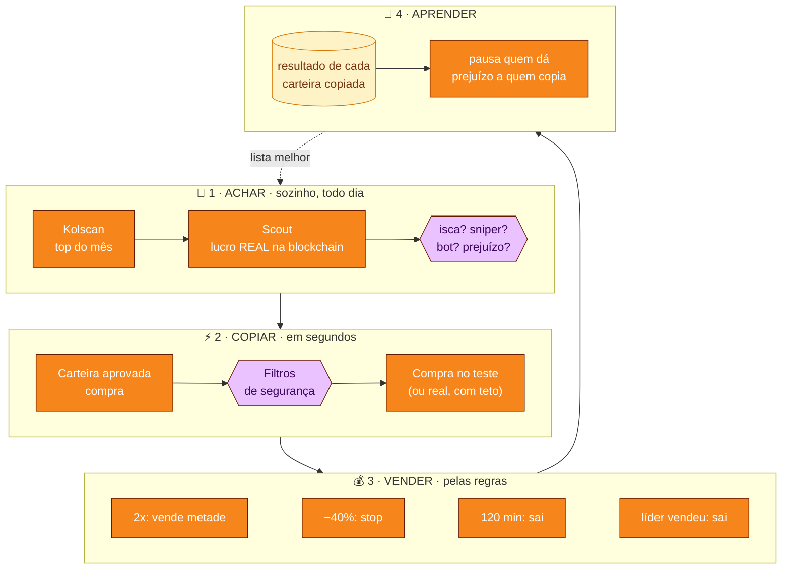

  

<h1 align="center">Memecoin Lab</h1>

  Copia as carteiras que mais lucram com memecoins na Solana, <b>primeiro em papel</b>, 
  e só deixa usar dinheiro de verdade quando o teste provar que dá lucro para quem copia.

  
  
  
  

## O que ele faz

- **Acha carteiras boas sozinho:** todo dia pega o top do Kolscan, lê o histórico real de cada carteira na blockchain e descarta isca, sniper, bot e quem só mostra o lucro e esconde o prejuízo.
- **Copia em papel, com preço de verdade:** quando uma carteira aprovada compra, o laboratório "compra" junto com atraso, taxa e slippage reais (cotação Jupiter), e vende pelas regras: lucro em 2x, stop, tempo e quando o líder vende.
- **Barra moeda perigosa:** dono que ainda pode criar moedas ou congelar, liquidez baixa, 10 maiores com quase tudo, criador com muito.
- **Radar:** avisa quando várias carteiras sem ligação compram a mesma moeda.
- **Aprende:** carteira que dá prejuízo para quem copia é pausada sozinha.
- **Dinheiro real só depois do portão:** 4 semanas, 200 operações e lucro depois das taxas. Mesmo ligado, tem teto por compra, por dia e botão de parar tudo.
- **Telegram:** avisos de compra e venda, painel com botões, vender pelo celular com confirmação, resumo às 21h.

## Instalar

1. Baixe o **MemecoinLab.exe** pelo botão acima.
2. Clique com o botão direito no arquivo → **Propriedades** → marque **Desbloquear** → **OK**.
3. Abra. Se aparecer *"O Windows protegeu o computador"*, clique em **Mais informações → Executar assim mesmo** (o programa não é assinado por empresa).
4. Siga a tela de boas-vindas: chave grátis do Helius, carteiras e ligar o laboratório.

Não precisa instalar Python nem mais nada. Versões novas aparecem sozinhas: **Atualizar agora**, e ele reabre na versão nova.

## Como ele decide

| | Tela | O que mostra |
|:-:|---|---|
| 📈 | **Painel** | Lucro e prejuízo ao vivo, gráfico, posições com termômetro do stop ao alvo, fita do que está acontecendo. |
| 📡 | **Radar** | Moedas que várias das suas carteiras compraram juntas. |
| 👛 | **Carteiras** | Quem é vigiado, a nota de cada uma e a busca automática. |
| 🛡️ | **Checar moeda** | Cole o endereço e veja se passa nos filtros e os sinais sociais. |
| 🎛️ | **Estratégia** | Quando vender, filtros e tamanho das entradas, com análise de risco. |

| Carteiras | Estratégia |
|---|---|
|  |  |

> [!WARNING]
> **Memecoins são de altíssimo risco.** A maioria vai a zero e a maioria de quem copia carteiras perde dinheiro. O programa existe para **medir antes de arriscar**. Não é recomendação de investimento.

<!-- NOVIDADES:INICIO -->
## Novidades

### 2.37 · 26/10/2026
- Telegram: quando o programa encontra uma versão nova, manda uma mensagem só por versão (não repete ao reabrir), com as novidades e o botão Atualizar no PC, que pede confirmação. Só funciona com o programa .exe; rodando pelo Python ele avisa que não dá.

### 2.36 · 25/10/2026
- Corrigido: o letreiro "Acontecendo agora" (breaking news) do Painel tinha parado de correr na 2.35. O visual novo desligava todas as animações quando o Windows estava com os efeitos de animação desligados, passando por cima da sua escolha em Ajustes › Movimento. Agora vale só a sua escolha ("Sempre", "Seguir o Windows" ou "Parado"), como na 2.34. Voltaram a se mexer também a bolinha "ao vivo", o carregando, o fundo animado do Painel e o aviso piscando.
- Letreiro: tocar numa moeda abre a ficha dela; passar o mouse pausa.
- Telegram: todas as mensagens antigas ganharam o visual novo. Compra (entrada, motivo, como sai), venda (resultado em R$ e SOL, entrada → saída, tempo na posição, motivo e o resultado do dia), sininho, venda parcial e rug viram cartões com título e ícones fixos.
- Telegram: o botão Gráfico dos avisos agora manda a imagem do gráfico aqui no chat (antes abria um site), e há o botão Ficha. Os links do X, pump.fun e DexScreener ficam numa linha só.
- Telegram: menu em grade com Atualizar; Posições mostra um cartão por posição (resultado ao vivo, Vender, Gráfico, ◀ ▶ e Atualizar) trocando na mesma mensagem; Mercado abre a ficha da moeda no chat; Status, Favoritas, Várias juntas, Carteiras, Aprendizado, Resumo do dia e Ajustes com o mesmo cabeçalho e hora da atualização; Vender tudo mostra a lista e o resultado somado antes de confirmar.
- Convergência rápida e Holder: só contam carteiras avaliadas como boas pelo scout. Antes, carteiras do garimpo ainda sem nota contavam (vimos 13–14 delas disparando o sinal na mesma moeda).

### 2.35 · 25/10/2026
- Convergência rápida: quando 5 carteiras boas compram a mesma moeda em 15 min, o programa marca o sinal na 5ª compra. Começa em modo sombra (só anota o que teria comprado, para medir); em Estratégia › Convergência rápida dá para mudar para comprar no teste. Carteiras ruins não contam.
- Vigia não perde mais compras das carteiras só observadas: o limite agora é por carteira e moeda (antes, 1 aviso a cada 30 s por carteira descartava compras de outras moedas). O Radar usa a mesma contagem, sem as carteiras ruins.
- Carteira ruim fica fora de vez: veredito prejuízo real, isca, sniper ou robô, ou média negativa depois de 8 cópias, bloqueia para sempre (antes era a geladeira de 6 h). A busca de carteiras não recoloca nem reavalia para melhor quem já deu prejuízo real, nem o Avaliar completo.
- Mais rápido: fontes opcionais que já entregam a troca pronta (PumpPortal e Helius Parsed Streams), com o vigia de sempre como reserva; espera entre leituras da transação caiu de 1 s para 0,3 s. Ficam desligadas até você colocar a chave (Ajustes) e ligar em Estratégia › Velocidade.
- Preço das posições trade a trade pelo PumpPortal (opcional) e conferência das posições a cada 5 s quando há chave da Jupiter (antes 20 s).
- Atraso medido do bloco até o aviso aparece no log a cada 30 min; o atraso simulado do teste pode usar essa medida (paper.latency_seconds: auto).
- Por conta própria: nota mínima continua 70; a convergência rápida entrou como variável do modelo.
- Testamos todos os botões do programa (computador e celular). Corrigido: Radar e Checar moeda abriam em branco; ícones de moeda sem foto geravam erros; um ícone com endereço estranho derrubava a resposta.
- Visual no estilo Apple: fonte do sistema (sem baixar fontes da internet), cores do sistema, vidro fosco na barra lateral e no topo, botões de 44 px, controles segmentados e chaves no estilo iPhone, janelas que sobem de baixo no celular, animações suaves (e desligadas se o sistema pedir menos movimento).
- Telegram: ficha da moeda que se atualiza no mesmo lugar, com gráfico (imagem) e botões Atualizar, Favoritar, DexScreener e Menu; avisos de alta e queda por posição e por favorito com níveis e intervalo configuráveis (sem repetir); cartão de convergência rápida.
- Holder (novo, só no teste por padrão): quando 3 carteiras boas compram juntas nos primeiros 30 min de vida da moeda, o programa dá uma nota de 0 a 100 com motivos e riscos e abre um hold de teste de R$ 100, sem stop curto: recupera o capital em 2x, vende 20% em 5x, 10% em 10x, 10% em 70x e deixa 10% correndo. No máximo 10 holds e R$ 1.000. Avisos no Telegram em 2x, 5x, 10x, 70x, 140x e em −50% do pico. A tela Holder mostra o retorno com e sem os 3 maiores.
- Holder com dinheiro real: chave própria, desligada; ligar pede o PIN. O portão (30 dias, 300 holds, retorno sem os 3 maiores acima de 1x) aparece só como aviso. A compra real ainda exige o dinheiro real ligado e respeita os limites dele e do holder.

### 2.34 · 25/10/2026
- Corrigido: depois de comprar pelo popup, a tela ficava em branco com "Memecoin Lab › undefined" (os botões de valor eram confundidos com botões de tela).
- Sininho mais confiável: tocar em −20% agora marca o degrau (antes vinha marcado e o toque desmarcava), o valor digitado não some ao trocar de opção, valor vazio não vira "só aviso" escondido, e uma compra que falha por motivo passageiro (Jupiter ocupada, sem rota) tenta de novo por até 10 min em vez de queimar o degrau.
- Telegram: compra com dinheiro real na ficha da moeda, com valor e PIN de 6 números. O bot apaga a mensagem do PIN, o pedido vale 2 min, só o seu chat é atendido e valem os limites do modo real. Só aparece com o dinheiro real ligado.

<!-- NOVIDADES:FIM -->

---

Feito por <b>HBS</b> · <a href="https://github.com/HenioSampaio">github.com/HenioSampaio</a>

